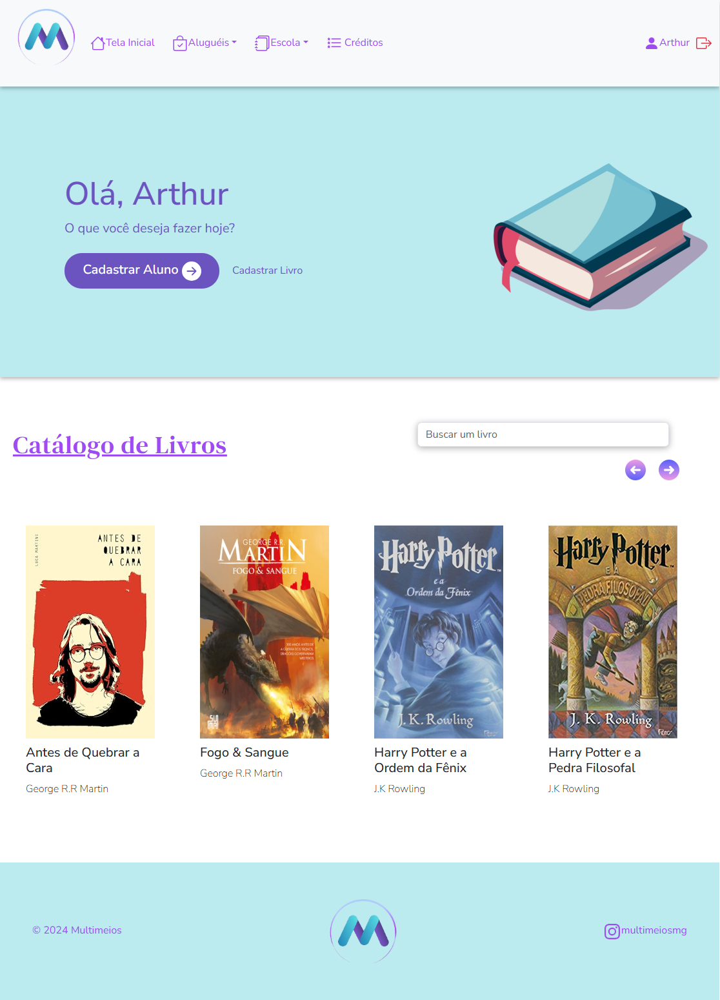
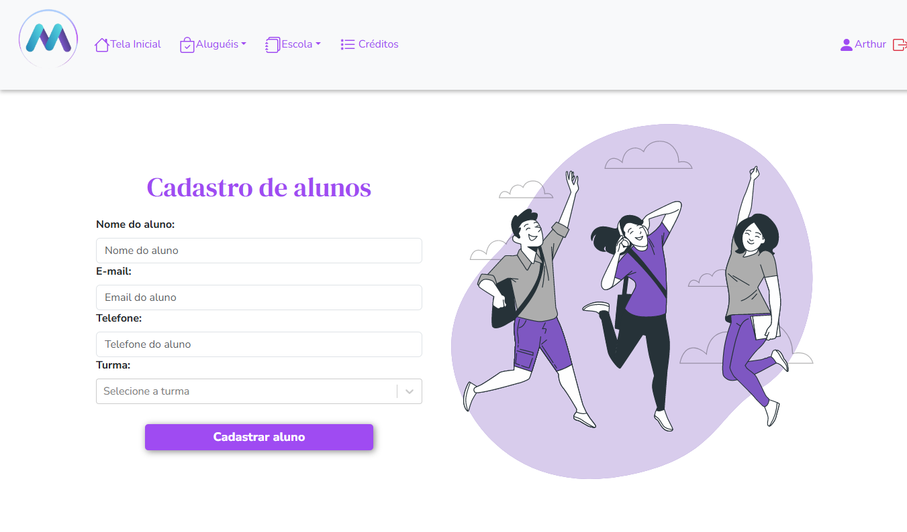
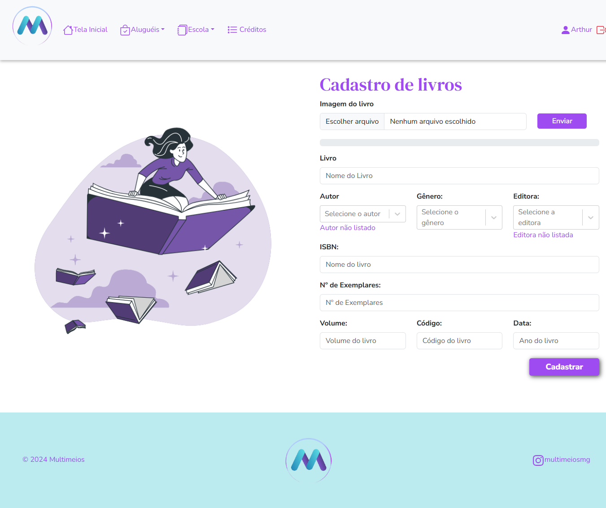
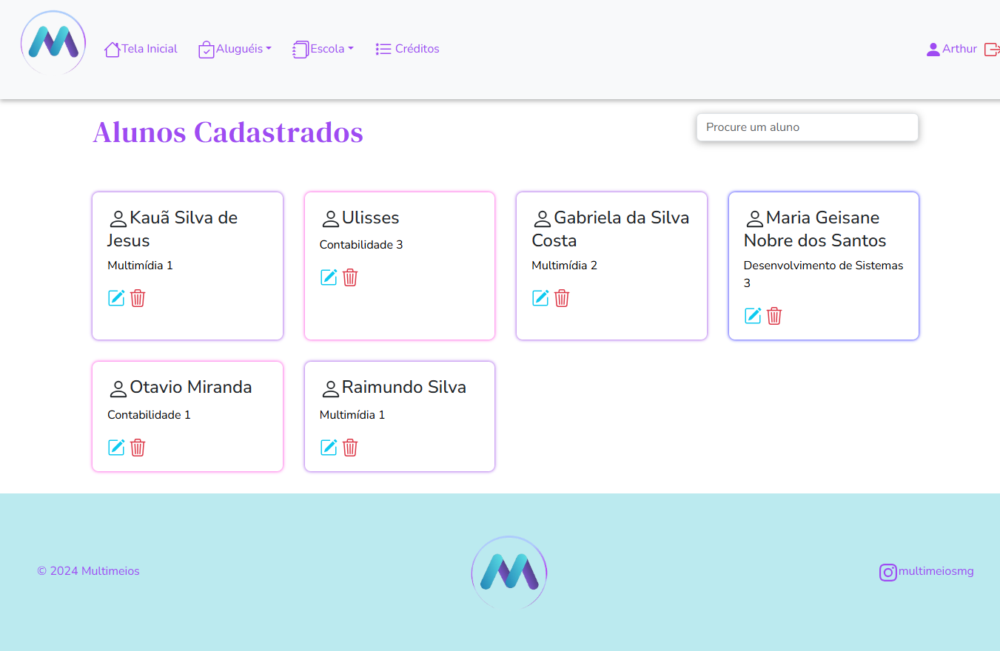
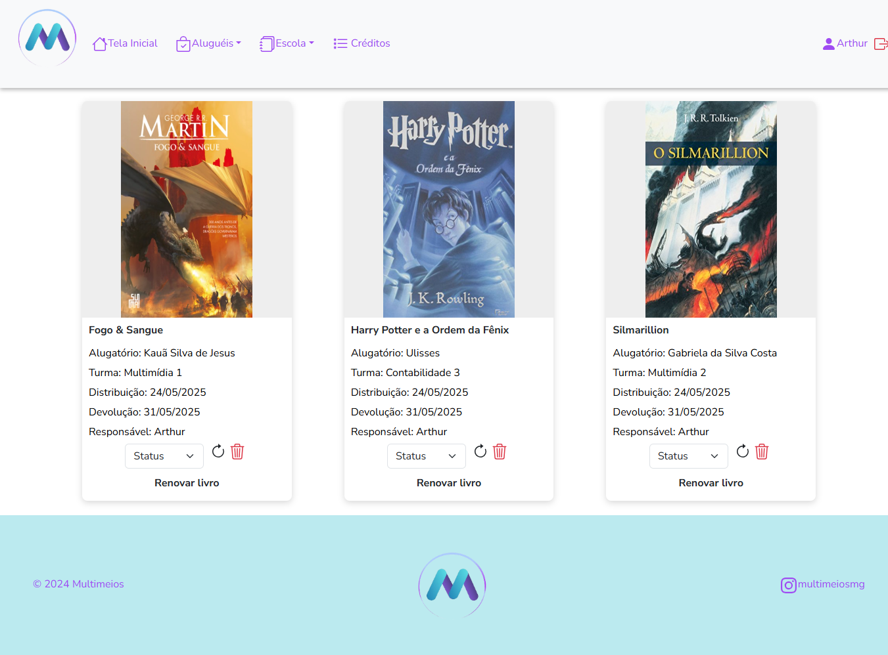
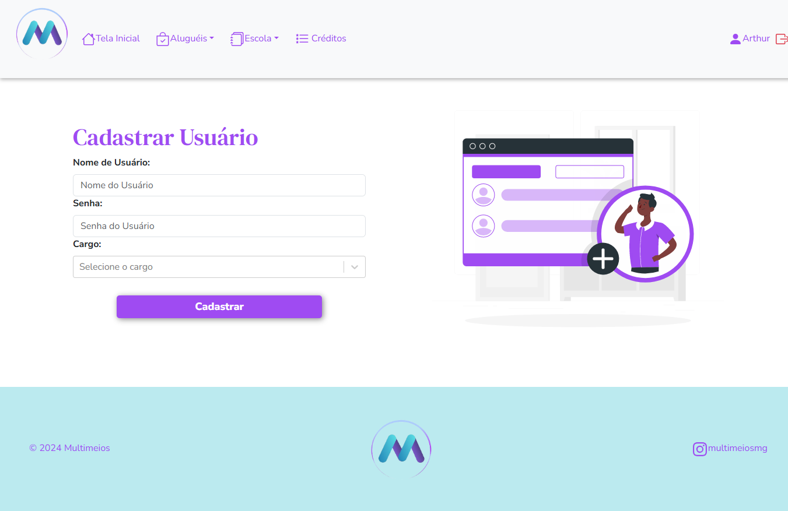

# 📕 Biblioteca Multimeios

Aplicação voltada para a biblioteca de escola, tendo como maior objetivo agilizar, facilitar e permitir maior controle a cadastro de livros, aluguéis de alunos e vizualização dos livros disponíveis.

## 🛠️ Tecnologias

 	

## 💻 Demonstração

## 🔴 Vídeo de Demonstração: 
Aqui está um vídeo das funcionalidades do projeto sendo executadas: [Link para vídeo](https://youtu.be/1holAouJD1o?si=aze3t7i0mWRJzoqK)

## 🏃🏻‍♂️‍➡️Próximos Passos
Futuramente este projeto será refatorado com tecnologias mais modernas, dentre elas: 

- Vite
- TypeScript
- TailwindCSS

